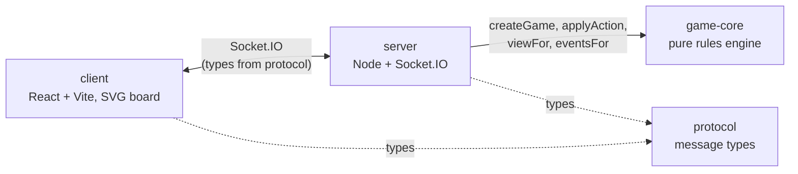

# Ada

A turn-based, room-code multiplayer island-building game for 2–5 players, inspired by classic hexagonal island trading games. Every player starts with a **role** that bends the rules in a different way. Play in the browser on a phone or desktop, no account needed.

**Status:** playable end to end (lobby, reconnection, full rules, five roles, three maps, Turkish and English UI). No accounts, matchmaking, chat or persistence yet. See [Status and roadmap](#status-and-roadmap).

## Highlights

- **Authoritative server with a secret-information filter.** Clients send actions; the server validates and applies them. A client only ever receives `viewFor(state, playerId)`: opponents' hands, the development-card deck contents and its order never leave the server, only counts do. Events are redacted per recipient the same way.
- **Pure TypeScript rules engine.** `applyAction(state, playerId, action, rng) → {ok, state, events} | {ok: false, error}`. No network, files, clock or `Math.random` inside; state is plain JSON; randomness comes only from the injected `rng`.
- **The core produces events, not text.** Events and errors are `{type, ...values}`; the client translates them (Turkish and English, same keys enforced by tests).
- **One validator for rules and UI.** The functions that validate a move are the same ones that list legal moves for highlighting, so the board can't show something the server will reject.
- **Fuzz testing with invariants.** Bots play hundreds of games with legal moves and every step is checked: no negative resources, conserved bank + hand totals, a 25-card development deck, piece limits, the distance rule, longest-road ownership, and scores recomputed from structures.
- **200-seed leak sweep.** 200 seeded bot games are played through real WebSockets and every message sent to every client is checked for hidden information.
- **Deterministic Playwright e2e.** Two mobile browser contexts play against test servers started with fixed seeds, so dice and decks are reproducible.
- **Role system via hooks and role actions.** Passive abilities are hooks, active abilities are actions the role defines. The core never branches on a role name (a test enforces it), and the role list is data.
- **Single-process deployment.** One Node process serves the Socket.IO game server and the built client on the same port.
- **Maps are data.** Three layouts (19, 30 and 14 tiles) are `MapDef` values, validated by `validateMap`; adding a map means adding data.

## Architecture



| Package | Responsibility |
| --- | --- |
| `packages/game-core` | Rules engine: validation, reducer, production and trade, scoring (longest road, largest army, hidden points), development cards, roles, maps, `viewFor`/`eventFor` redaction, legal-move listers, bot simulation and balance script. No I/O. |
| `packages/protocol` | Types shared by client and server: event names, `LobbyView`, error keys. |
| `packages/server` | Socket.IO transport, rooms and lobby, identity (signed random tokens), reconnection, input validation, rate limiting. Talks to the core only through its public functions. Includes a terminal client (`npm run cli`) for manual testing. |
| `packages/client` | Vite + React, mobile-first SVG board drawn from `MapDef`, dice and production animation, trade sheet, i18n (tr/en). Does not reimplement rules: legal moves and rejection reasons come from the server. |

## Running it

```bash
npm install

# development: client dev server (Vite, :5173); start the game server separately
npm run server          # game server on :3001 (set CORS_ORIGINS='*' for the dev client)
npm run dev             # http://localhost:5173, proxies /socket.io to the server

# single process: server + built client on :3001
npm run build
npm run start           # http://localhost:3001
```

**On a phone (same Wi-Fi):** run `npm run build && npm run start`, find the computer's local IP (`ipconfig` on Windows, `ip addr` on Linux), and open `http://<that-ip>:3001` on the phone. Windows may ask to allow Node.js on private networks. Create a room on one device and join with the 4-letter code on another.

**`SERVER_SECRET`:** player identities are signed with this value. Set it to a long, random, stable string in any real deployment. If it is unset the server generates a random key on every start, so every issued identity becomes invalid on restart and players can't return to their open rooms. Also set `CORS_ORIGINS` to the actual origins (not `*`) and `PORT` as needed. Rooms are held in memory and are lost on restart.

## Testing strategy

| Layer | What it checks | Where |
| --- | --- | --- |
| Unit | Maps (3 layouts × 300 seeds), setup, building, production and bank stock, robber and discards, trade and ports, longest road, development cards, all five roles; client reducers, view logic and i18n key parity | `packages/*/test` |
| Fuzz | 200 random-bot games (2–5 players, every role, both modes) plus 48 greedy-bot games, with every invariant checked at every step; validator and reducer must agree | `packages/game-core/test/fuzz.test.ts` |
| Leak | `viewFor` and `eventFor` are unchanged by opponents' secrets; 200 seeded games over real WebSockets with every outgoing message inspected | `packages/game-core/test/view.test.ts`, `packages/server/test/leak-*.test.ts` |
| Server integration | Rooms, lobby rules, reconnection, malformed input, rate limits, full bot games over sockets compared against `viewFor` | `packages/server/test` |
| End to end | Playwright, two mobile contexts, seeded test servers: lobby, setup, dice, trade, a full short game, the Soldier's demolition, reconnection | `packages/client/e2e` |
| Balance report | Role win rates from random and greedy bots across player counts and modes (a report, not a pass/fail test) | `packages/game-core/scripts/balance.ts` |

Current counts from `npm test`: **143** client + **164** game-core + **96** server = **403** unit/integration tests passing. `npm run e2e` runs **105** Playwright scenarios.

```bash
npm test             # all unit, fuzz, leak and server tests
npm run typecheck
npm run build
npm run e2e          # build first; once: npx playwright install chromium
npm run balance      # npm run balance -- --games=300 --seed=2
                     # measure a candidate Soldier price list without changing the code:
                     # npm run balance -- --costs="settlement=ore:2,wool:1/city=ore:3,wool:2,grain:2"
```

The end-to-end servers use test-only switches (`ADA_TEST_SEED`, `ADA_TEST_VP`, `ADA_TEST_RESOURCES`, `ADA_TEST_CREATE_LIMIT`). They are read only when `NODE_ENV` is exactly `test`; a server test proves each is ignored anywhere else.

## Status and roadmap

**Works today:** lobby with room codes, role selection, standard (10 points) and short (7 points) modes, three maps, the full turn cycle with bank/port/player trading (a side-by-side give/get sheet), development cards, robber, longest road and largest army, five roles (the Soldier pays resources to demolish a rival's road, settlement or city), player seats round the board with points and card counts (never which cards), reconnection after refresh or dropped connection, Turkish and English.

**Known gaps:**

- Role balance is not settled: in bot simulations one role wins above its even share and another below it; real playtesting comes first. The Soldier's demolition price was tuned against two bots (about −2.5 points from an even share with the greedy bot, −6 with the random bot). A known long-game case, where the Soldier grinds a rival down to one building and the game drags on, has a proposed guard that is **not** implemented. Details are in [docs/DECISIONS.md](docs/DECISIONS.md).
- On a 360×640 phone the board is small in the Soldier's demolish mode (the preview panel takes room); pinch to zoom.
- The 30-tile and 14-tile layouts and short mode with five players are assumptions not yet validated by human play.
- Rooms are in memory only; no turn timer, accounts, matchmaking, spectators or chat.
- Rate-limit values and longest-road cost under load have not been measured.

**Next:** playtesting and rebalancing, persistent rooms, turn timers, accounts and matchmaking, and wrapping the same web code with Capacitor for iOS and Android (planned, not started).

Design document: [docs/GDD.md](docs/GDD.md) (in Turkish). Decisions and assumptions log: [docs/DECISIONS.md](docs/DECISIONS.md).

---

## Kısa Türkçe özet

Ada, oda koduyla oynanan, tur tabanlı, 2–5 kişilik bir ada kurma oyunudur; klasik altıgen ada ticaret oyunlarından esinlenmiştir ve her oyuncu farklı bir rolle başlar. Sunucu otoritedir: istemciye yalnızca `viewFor` çıktısı gider, rakibin eli ve deste sırası asla gitmez. Kural motoru saf TypeScript'tir, metin değil olay üretir (tr/en çeviri istemcide). Güvenceler: botlarla yüzlerce oyunluk fuzz testi ve değişmezler, 200 tohumlu sızıntı taraması, tohumlu Playwright e2e. `npm install`, `npm run build`, `npm run start` ile tek süreçte http://localhost:3001 adresinde çalışır; canlıda `SERVER_SECRET` sabit olmalıdır. Güncel testler: 403 birim/entegrasyon + 105 e2e. Tasarım: [docs/GDD.md](docs/GDD.md).
